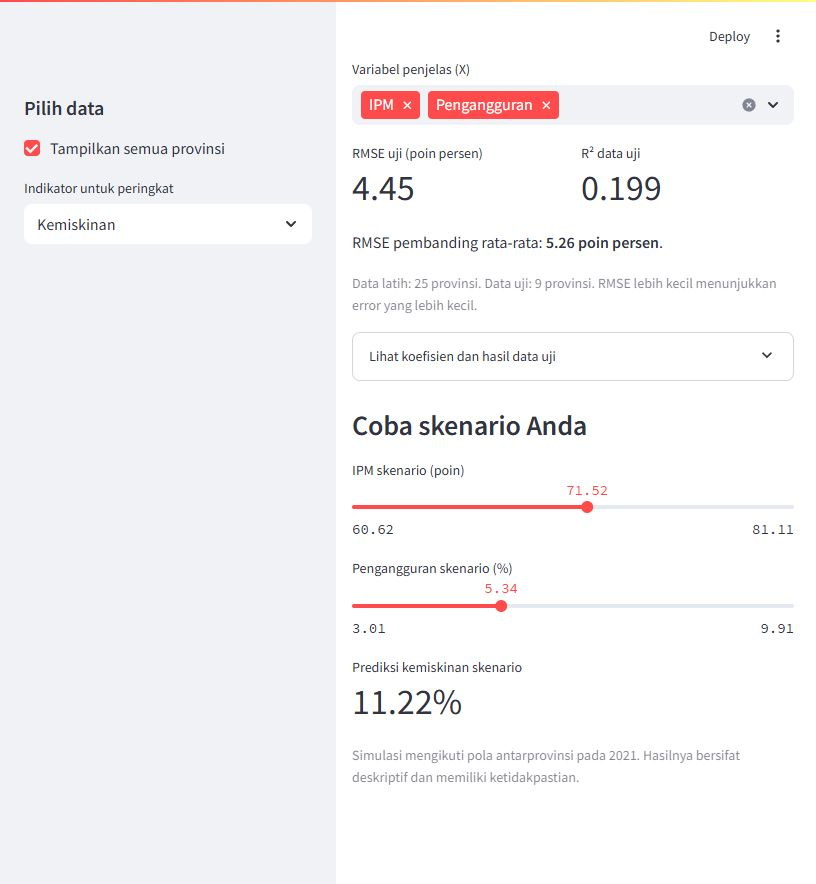

# Penutup: membuat dashboard ekonomi Indonesia

Buka [01_dashboard_ekonomi.ipynb](01_dashboard_ekonomi.ipynb), atau
[langsung buka di Colab](https://colab.research.google.com/github/akhiyarwaladi/ekonometrika_coding_workshop/blob/main/materi/04_dashboard_indonesia/01_dashboard_ekonomi.ipynb).
Seluruh kode aplikasi dan langkah menjalankannya ada di notebook.
Peserta cukup menjalankan sel; tidak perlu membuka terminal.

1. Di Colab, simpan salinan notebook lalu unggah [data_tutorial.zip](../../paket/data_tutorial.zip) melalui panel **Files**.
2. Jalankan sel dari atas, termasuk instalasi dan persiapan data.
3. Empat sel `%%writefile` menyimpan bagian aplikasi; masing-masing dapat dijalankan ulang.
4. Jalankan sel server dan sel pratinjau. Di Colab, dashboard tampil dalam keluaran notebook.
5. Coba filter, grafik, regresi, dan slider. Akhiri dengan tantangan presentasi dua menit.

Dashboard memakai data 34 provinsi pada **2021**. Pengguna dapat memilih provinsi,
membandingkan IPM, pengangguran, dan kemiskinan, melatih regresi scikit-learn,
membaca RMSE/R², mencoba skenario, serta mengunduh data hasil filter.
Tabel arti variabel disediakan sebelum data dibaca.

Folder `hasil_dashboard/` dibuat otomatis saat notebook dijalankan. Berkas `.py`
di sebelah notebook adalah sumber penyuntingan bagi pengajar, mengikuti format
materi sebelumnya. Peserta menjalankan versi `.ipynb`.

**Durasi yang disarankan:** 60 menit. Setelah selesai, ubah `hentikan_dashboard`
menjadi `True` pada sel terakhir dan jalankan sel itu. Menutup runtime Colab
juga menghentikan aplikasi.

Notebook telah diuji pada kernel Jupyter lokal. Interaksi aplikasi diperiksa
otomatis dan tampilannya dibuka di browser. Pratinjau Colab memakai fasilitas
bawaan Colab; pengujian langsung pada sesi Colab belum dilakukan.
