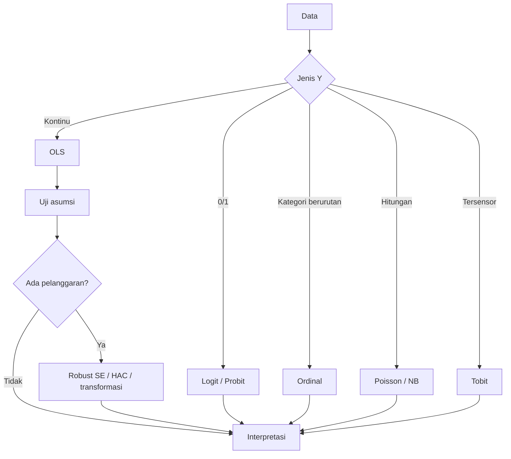

# Panduan mengajar

Mulai dari [README utama](../README.md) untuk memilih notebook dan membuka Colab.
Kunci jawaban tersedia di [kunci_jawaban/](kunci_jawaban); nama filenya sama dengan latihan.
[Pembahasan latihan](README.md#pembahasan-latihan) dipakai setelah peserta mencoba.
[Rencana kelas](#kegiatan-sesuai-undangan-satu-hari-untuk-peserta-pemula) · [Dashboard](#dashboard-penutup-60-menit) · [Pembahasan](#pembahasan-latihan) · [AI](#pendampingan-ai) · [Pemodelan](#pemodelan) · [Sumber](#sumber)

Panduan ini untuk pengajar atau presenter. Isinya jalur kegiatan sesuai
undangan 26 Oktober 2026, paket pendalaman dua hari, poin
mengajar per sesi, kesalahan umum peserta, dan rencana cadangan kalau ada
kendala teknis.

## Kegiatan sesuai undangan: satu hari untuk peserta pemula

Surat menetapkan Senin, 26 Oktober 2026, pukul 08.30 WIB sampai selesai,
di Ruang Gedung Hexagonal Lantai 2 Universitas Jambi, dengan tema
Ekonometrika berbasis AI dan Coding. Surat tidak menetapkan jadwal dua
hari, rincian latar belakang peserta, atau jam penutupan. Jadwal berikut
adalah usulan mengajar sampai sekitar pukul 16.00, untuk disesuaikan dengan
alokasi panitia.

| Perkiraan waktu | Materi | Cara mengajar |
|---|---|---|
| 08.30-09.15 | Panduan pemula dan Sesi 0 | Baca beberapa format, periksa kualitas tabel, rangkum angka, dan lakukan EDA. |
| 09.15-10.15 | Sesi 1 | Jalankan OLS, baca satu koefisien, ubah satu nilai prediksi. |
| 10.15-10.30 | Istirahat | |
| 10.30-11.15 | Contoh inti Sesi 2 | Bandingkan garis lurus dan kuadratik, lalu jelaskan elastisitas log-log. |
| 11.15-12.00 | Contoh inti Sesi 3 | Basis dummy, VIF, Breusch-Pagan, dan HC3. |
| 12.00-13.00 | Istirahat | |
| 13.00-13.40 | Praktik AI | Pakai pengajar/README.md: jelaskan kode, periksa output, pahami satu error. |
| 13.40-14.40 | Praktik Lab 1 | Peserta mengubah contoh untuk kasus padi dan menjelaskan hasil. |
| 14.40-15.00 | Pembahasan | Koreksi interpretasi satuan, p-value, dan klaim sebab akibat. |
| 15.00-16.00 | Dashboard penutup | Buat grafik interaktif, ubah skenario, lalu buka tautan ngrok dari notebook. |

Target minimum: peserta dapat membaca CSV, menjalankan OLS, membaca
koefisien/p-value, membuat prediksi, dan memeriksa bantuan AI menggunakan
output aktual. Sesi 4-6 dan Lab 2-6 tetap dibagikan sebagai pendalaman.
Jika alokasi acara lebih singkat, utamakan persiapan, OLS, interpretasi,
dan satu latihan AI; beri waktu peserta menjalankan setiap langkah.

Mulai dengan `README.md#dasar-notebook`. Jelaskan setiap perintah baru saat
muncul. Peserta tidak diminta menulis fungsi, perulangan, optimisasi
likelihood, atau perkalian matriks. Perhitungan teknis Tobit tersedia
terbuka di `alat_bantu/metode_lanjutan.py` dan ikut paket ZIP.

## Pilihan pendalaman dua hari

- **Hari 1 (dosen/pengajar):** mengenal Python untuk ekonometrika,
  menyiapkan bahan ajar, dan menuntaskan alur analisis dari regresi sampai
  model lanjutan.
- **Hari 2 (mahasiswa):** praktik terbimbing dengan latihan mandiri di
  setiap topik, ditutup proyek mini.
- **Alat:** Google Colab. Tidak perlu instalasi apa pun di laptop peserta.
- **Data:** notebook membaca CSV langsung dari GitHub melalui `URL_DATA`.
  Gunakan koneksi internet. Salinan lokal: 45 CSV aktif di `data/`, sedangkan
  14 CSV tambahan berada di `data/latihan_tambahan/`. Lab 6 memakai data Indonesia
  (IHSG, kurs, makro, panel ASEAN) dari salinan GitHub tersebut.
  [Peta pemakaian data](../data/README.md#data-yang-dipakai-tiap-notebook) menunjukkan nama CSV per sesi.

## Pengenalan berbagai format data

Sesi 00 memakai tujuh format dengan tujuh kasus berbeda. CSV berisi makro Indonesia;
Excel berisi produksi padi dan beras kabupaten/kota Jawa Barat pada 2025;
SPSS berisi kemiskinan; Stata berisi penggunaan internet; TSV berisi ekspor;
JSON berisi prakiraan cuaca Simpang IV Sipin, Jambi; Parquet berisi jumlah penduduk.
CSV makro tetap di `data/`; enam format lain ada di `data/contoh_format/`.

Baca tabel Kenali data sebelum membuka berkas. Bandingkan jumlah baris, jenis kolom,
unit pengamatan, periode, dan satuannya. SAV, DTA, TSV, dan Parquet dikonversi dari
seri publik World Bank untuk demonstrasi format. Excel menyalin tabel BPS,
sedangkan JSON BMKG diratakan. Semua sumber ditautkan di notebook; contoh SPSS
bukan mikrodata survei. Prakiraan cuaca juga harus dibedakan dari pengamatan aktual.

Untuk pengantar 45 menit, utamakan CSV, Excel, dan SPSS, lalu pemeriksaan nilai kosong,
ringkasan, grafik garis, dan histogram. Empat format lain serta grafik peringkat dan
diagram pencar dapat dilanjutkan pada Lab 00. Versi lengkap memerlukan sekitar
60 sampai 75 menit, bergantung pada waktu praktik peserta.

Tabel Perintah pada tahap ini menjelaskan kegunaan, masukan/argumen, dan hasil
fungsi. Fungsi yang sudah dijelaskan tidak diulang pada setiap sel. Regresi dimulai
di Sesi 01; Sesi 00 hanya EDA. Lab 05 menggabungkan Sesi 05 dengan bagian panel
Sesi 06. Tidak ada langkah unggah ZIP atau menjalankan terminal bagi peserta.

## Benang merah mengajar

Materi ini satu cerita: Sesi 1 memasang model linear dan menunjukkan
kegagalannya, Sesi 2 memilih bentuk yang tepat, Sesi 3 menguji asumsi,
Sesi 4 mengganti jenis variabel Y, Sesi 5 menambah waktu, dan Sesi 6
melanjutkan ke panel serta GARCH. Latihan mengulang alur yang sama
dengan data Indonesia, lalu dashboard menyatukan tabel, grafik, dan model menjadi
aplikasi yang bisa dicoba peserta.

Dua kebiasaan yang menjaga alur tetap terasa di kelas:

1. Buka setiap sesi dengan membaca blok "Posisi dalam alur workshop" di
   notebook, satu menit saja.
2. Tutup setiap sesi dengan bagian "Selanjutnya" supaya peserta tahu
   kaitannya dengan pertemuan berikutnya. Bagikan `README.md` sebagai
   rujukan istilah.

Saat bagian "Coba sendiri" atau latihan EDA muncul, hentikan demo dan beri
peserta waktu mencoba. Bahas tabel dan grafik yang mereka peroleh sebelum
melanjutkan ke konsep berikutnya. Gunakan kunci jawaban setelah peserta mencoba.

## Pengayaan dunia nyata pada Sesi 03 sampai 05

Pengayaan berada pada contoh, latihan, dan kunci jawaban yang sudah ada. Durasi berikut
merupakan tambahan di luar materi inti. Untuk kelas satu hari, pilih satu praktik;
pengayaan lain dapat dipakai pada pertemuan pendalaman. Dashboard tetap menjadi penutup.

| Sesi | Praktik | Tambahan waktu | Urutan mengajar |
|---|---|---|---|
| 03 | Evaluasi bantuan dengan DiD | 25 sampai 35 menit | Baca dua kelompok sebelum/sesudah, hitung empat rata-rata, cocokkan koefisien interaksi, bahas asumsi. |
| 04 | Keputusan kredit berdasarkan biaya | 30 sampai 40 menit | Baca kelas, pisahkan latihan/validasi/uji, latih logit, pilih di antara dua ambang pada validasi, nilai biaya uji. |
| 05 | Pengujian ramalan inflasi Indonesia | 30 sampai 40 menit | Buat lag, pisahkan waktu, validasi pada 2021/2022/2023, latih sampai 2023, bandingkan ramalan pada 2024 sampai April 2025. |

**Sesi 03.** Delapan baris dibuat langsung di notebook supaya peserta dapat menghitung
ulang angkanya. Satu baris adalah kelompok-tahun, bukan rumah tangga. Kenaikan peserta
0,7 juta dikurangi kenaikan pembanding 0,4 juta memberi DiD 0,3 juta rupiah per bulan.
Koefisien interaksi scikit-learn harus sama. Jangan menambahkan p-value pada delapan
agregat ini; pembahasan ketidakpastian mengikuti rancangan penelitian dengan banyak unit.
Kesamaan perubahan sebelum program hanya petunjuk, bukan bukti asumsi tren paralel.
Bahas pula program lain, perubahan komposisi, antisipasi, dan pengaruh ke pembanding.
PKH pada referensi Cahyadi dkk. menggunakan penugasan acak; jangan menyebutnya studi DiD sederhana.

**Sesi 04.** `data/gagal_bayar_kredit_taiwan.csv` dipindahkan dari cadangan dan isinya dipertahankan.
Asal data Taiwan serta satuan dolar Taiwan tetap dijelaskan. Dua fitur, batas kredit dan
usia, cukup untuk latihan ini. Pembagian 600/200/200 memakai stratifikasi; patokan skala
dipelajari dari 600 data latihan. Ambang 0,20 dan 0,50 dibandingkan menggunakan asumsi biaya
1 unit untuk nasabah lancar yang ditolak dan 5 unit untuk gagal bayar yang terlewat.
Pilihan tersebut dibekukan sebelum penilaian 200 nasabah uji. Grafik membandingkan juga
aturan terima semua dan tolak semua. Ikuti hasil aktual, termasuk jika aturan sederhana
lebih murah. Ini pengantar keputusan, bukan model persetujuan kredit yang siap digunakan bank.

Pada pembagian yang diuji, ambang 0,20 memberi biaya uji 132 unit, dibandingkan 220
untuk terima semua dan 156 untuk tolak semua. Akurasi logit 46%, sedangkan 38 dari
44 gagal bayar terdeteksi (86,4%). Minta peserta menjelaskan mengapa penilaian
berdasarkan biaya dapat berbeda dari penilaian berdasarkan akurasi.

**Sesi 05.** Gunakan inflasi YoY dalam persen, bukan level IHK. MAE/RMSE memakai satuan
poin persentase. `lag_1` dan `lag_12` dibuat dengan mengambil masa lalu; tidak ada pembagian
acak. `TimeSeriesSplit` memberi tiga validasi tahunan sebelum 2024. Ramalan uji adalah
satu bulan ke depan yang diulang menggunakan realisasi bulan sebelumnya; koefisien model
tetap berasal dari latihan sampai 2023. Ini tidak sama dengan meramal 16 bulan sekaligus.
Jeda publikasi diabaikan dalam demonstrasi, sehingga aplikasi operasional perlu menyesuaikan
ketersediaan informasi. Salinan data berakhir April 2025 dan bukan data inflasi terkini.

Pada rentang uji ini, MAE naif sekitar 0,372 poin persentase, lebih rendah daripada
regresi dua lag sekitar 0,419. Pertahankan contoh ini untuk menunjukkan bahwa
tambahan fitur tidak otomatis memperbaiki ramalan; jangan mencari pembagian lain
hanya untuk membuat regresi terlihat unggul.

Perintah baru dijelaskan saat muncul: `unstack`, `idxmin`, `StandardScaler`, `shift`,
`TimeSeriesSplit`, dan `cross_val_score`. Peserta tidak perlu menulis fungsi atau perulangan.
Tabel Kenali data tersedia sebelum pembacaan CSV atau pembuatan tabel simulasi.

Rujukan pengayaan:

- [World Bank: difference-in-differences](https://dimewiki.worldbank.org/Difference-in-Differences).
- [Cahyadi dkk. (2020): evaluasi PKH](https://economics.mit.edu/sites/default/files/publications/pol.20190245.pdf).
- [Duflo (2001): SD Inpres, pendidikan, dan upah](https://pubs.aeaweb.org/doi/10.1257/aer.91.4.795).
- [scikit-learn: keputusan berdasarkan biaya](https://scikit-learn.org/stable/auto_examples/model_selection/plot_cost_sensitive_learning.html).
- [UCI: data nasabah kartu kredit Taiwan](https://archive.ics.uci.edu/dataset/350/default+of+credit+card+clients).
- [scikit-learn: evaluasi ramalan dengan lag](https://scikit-learn.org/stable/auto_examples/applications/plot_time_series_lagged_features.html).
- [OECD melalui FRED: seri IHK Indonesia, basis 2015=100](https://fred.stlouisfed.org/series/IDNCPIALLMINMEI).

## Checklist sebelum hari-H

1. Uji buka setiap notebook di Colab sekali, jalankan dari atas ke bawah.
2. Periksa koneksi internet dan tautan CSV. Salinan offline opsional ada di
   [alat_bantu/paket/data_tutorial.zip](../alat_bantu/paket/data_tutorial.zip); jika mengajar offline,
   pengajar menyiapkan kernel beserta pustaka dan mengganti `URL_DATA` menjadi alamat folder `data/` lokal.
3. Sesi 6 memakai paket `linearmodels` dan `arch` yang tidak tersedia di
   Colab secara bawaan. Sel `%pip install` sudah disiapkan di notebook,
   tapi butuh internet. Kalau ruangan tanpa internet, minta peserta
   menjalankan instalasi di awal saat masih ada koneksi.
4. Cetak atau siapkan `pengajar/README.md` (Hari 1) dan folder `pengajar/kunci_jawaban/`
   (Hari 2) untuk Anda sendiri.
5. Siapkan akun Google peserta dan gladi bersih Colab menggunakan notebook
   terbaru. ZIP hanya disiapkan pengajar untuk kondisi tanpa internet.

## Paket pendalaman Hari 1 (dosen): sekitar 8 jam 15 menit materi

| Waktu | Sesi | Notebook | Fokus |
|---|---|---|---|
| 08.30-09.00 | Pembukaan + setup | `00_persiapan_colab.ipynb` | Colab, format data, dan EDA |
| 09.00-10.15 | Regresi dasar | `01_regresi_dasar.ipynb` | OLS, uji t/F, R kuadrat, prediksi |
| 10.15-10.30 | Istirahat | | |
| 10.30-11.45 | Bentuk fungsional | `02_bentuk_fungsional.ipynb` | log-log, reciprocal, polinomial |
| 11.45-13.00 | Istirahat | | |
| 13.00-14.30 | Dummy + asumsi klasik | `03_dummy_asumsi_klasik.ipynb` | VIF, BP/White, JB, DW |
| 14.30-14.45 | Istirahat | | |
| 14.45-16.00 | Model kategorikal | `04_model_kategorikal.ipynb` | logit, ordinal, tobit, poisson |
| 16.00-17.15 | Deret waktu | `05_deret_waktu_kointegrasi.ipynb` | ADF, ARIMA, kointegrasi, ECM |
| 17.15-18.30 | Panel + GARCH | `06_panel_garch.ipynb` | CEM/FEM/REM, GARCH |

Kalau waktu mepet, prioritas: sesi 1, 2, 3, lalu 4. Sesi 5 dan 6 bisa
diberikan sebagai bacaan mandiri dengan kunci yang sudah tersedia.

## Paket pendalaman Hari 2 (mahasiswa): sekitar 8 jam 45 menit materi

| Waktu | Lab | Fokus |
|---|---|---|
| 08.30-09.15 | `00_persiapan_colab.ipynb` | Colab, tabel, dan eksplorasi data |
| 09.15-10.45 | `01_regresi_dasar.ipynb` | regresi dan interpretasi |
| 10.45-11.00 | Istirahat | |
| 11.00-12.30 | `02_bentuk_fungsional.ipynb` | memilih bentuk model |
| 12.30-13.30 | Istirahat | |
| 13.30-15.00 | `03_dummy_asumsi_klasik.ipynb` | dummy dan diagnostik |
| 15.00-16.15 | `04_model_kategorikal.ipynb` | logit, ordinal, poisson |
| 16.15-17.15 | `05_deret_waktu_panel.ipynb` | ADF, ARIMA, panel |
| 17.15-18.15 | `06_data_indonesia.ipynb` | data asli: GARCH IHSG, panel ASEAN, makro Indonesia |
| 18.15-18.30 | `07_proyek_mini.md` | penjelasan tugas akhir |

Kalau waktu mepet, Lab 6 bisa dijadikan pekerjaan rumah. Datanya sudah
tersedia lokal dan kuncinya lengkap, jadi mahasiswa bisa mengerjakan
mandiri.

## Poin mengajar per sesi

Model utama memakai scikit-learn secara konsisten. Tunjukkan X dan y, buat model,
jalankan fit, baca coef_ serta intercept_, lalu predict. Nama `uji_...` menandai
pelengkap inferensi; jelaskan ketika peserta membutuhkan p-value atau diagnostik.
Untuk klasifikasi, bedakan predict (kelas) dan predict_proba (peluang).
Rinciannya ada di [panduan pemodelan](README.md#pemodelan).

### Sesi 1, regresi dasar
- Mulai dari scatter plot. Tanya peserta: "hubungannya garis lurus atau
  melengkung?" Pertanyaan ini yang menentukan bentuk model di sesi 2.
- Tunjukkan arti koefisien dengan angka konkret, bukan rumus.
- Tekankan `ceteris paribus`: koefisien adalah hubungan, bukan sebab
  akibat, kecuali desain penelitiannya mendukung.

### Sesi 2, bentuk fungsional
- Aturan praktis: log untuk persentase, reciprocal untuk titik jenuh,
  polinomial untuk pola naik-turun.
- Demo `iklan_penjualan.csv` di sesi 1 sengaja gagal dengan model linear.
  Buka kembali di sesi ini sebagai pay-off: model kuadratik memperbaiki
  R kuadrat dari 0,007 ke 0,999.

### Sesi 3, dummy dan asumsi
- Dummy selalu punya kategori basis. Minta peserta menyebut basisnya
  sebelum menafsirkan.
- Urutan diagnostik: multikolinearitas, heteroskedastisitas, normalitas,
  autokorelasi.
- Pesan kunci: robust SE mengubah standard error, bukan koefisien.

### Sesi 4, model kategorikal
- Data kursus untuk logit (`persetujuan_kredit_usaha.csv` sampai `penggunaan_mobile_banking.csv`) terpisah
  sempurna. Ini dijelaskan di notebook sebagai pelajaran. Jangan panik
  kalau peserta bertanya kenapa koefisiennya ekstrem.
- Dataset Spector dipakai sebagai contoh bersih. Bisa dibandingkan dengan
  hasil di buku teks.

### Sesi 5, deret waktu
- Urutan tidak boleh dilompati: stasioner dulu, baru kointegrasi, baru
  ECM. Kasus IHSG-emas di kunci menunjukkan kenapa.
- ADF pada kurs adalah contoh patahan struktural.

### Sesi 6, panel dan GARCH
- Hausman klasik memakai estimasi FE dan RE dengan kovarians unadjusted,
  bukan selisih kovarians clustered. Pada data GDP, p sekitar 0,8648.
  Laporkan angka terbaru, asumsi, dan keterbatasan uji.
- GARCH pada data simulasi murni ARCH (beta = 0). Bandingkan dengan
  simulasi GARCH asli di notebook supaya peserta melihat persistensi.

### Lab 6, data Indonesia asli
- Kasus ini menghubungkan teori dengan data dari World Bank, Yahoo Finance, ECB,
  OECD, dan kompilasi BPS, bukan simulasi.
- GARCH IHSG memberi hasil seperti di buku teks: beta 0,82 dan
  persistensi 0,95. Kontras dengan data simulasi (beta 0) yang sudah
  dibahas di Sesi 6.
- Panel ASEAN memakai uji Chow dan Hausman dengan data nyata; hasilnya
  memilih Fixed Effect dan koefisien FDI signifikan.
- Regresi inflasi dan pengangguran Indonesia menunjukkan tanda positif.
  Jangan buru-buru bilang "salah teori"; bahas konteks krisis 2005, 2008,
  dan 2020.
- Bagian krisis 1997-1998 memakai inflasi bulanan sejak 1969 dan kurs
  tahunan sejak 1967. Puncak inflasi YoY bulanan pada berkas
  ini sekitar 82,42 persen pada September 1998; rata-rata 12 angka YoY
  selama 1998 sekitar 58,01 persen. Bedakan puncak bulanan dari rata-rata.
  Kurs rata-rata tahunan melemah sekitar 244 persen pada 1998.
- Latihan GARCH jangka panjang memakai IHSG sejak 1990. Periode 1990-1999
  menyentuh IGARCH (alpha + beta = 1), temuan bagus untuk diskusi rezim
  krisis.
- Latihan cross-section memakai 34 provinsi 2021 (kemiskinan, IPM, PDRB).
  Cocok untuk mengulang materi bentuk fungsional dan heteroskedastisitas
  dengan data asli.
- Tunjukkan `pengajar/README.md` dan script `unduh_data_indonesia.py` supaya
  mahasiswa bisa memperbarui atau mengambil data sendiri untuk proyek.

## Kendala yang sering muncul

| Kendala | Solusi cepat |
|---|---|
| Pembacaan CSV gagal | Periksa koneksi internet, URL_DATA, dan ejaan nama CSV; ulangi sel terkait |
| `ModuleNotFoundError: linearmodels` | Jalankan sel `%pip install linearmodels arch -q`, tunggu selesai, lanjutkan |
| Angka beda dengan kunci | Cek versi paket; jalankan `pip show statsmodels arch linearmodels` |
| Warning "Perfect Separation" | Bukan error; itu bahan diskusi di sesi 4 |
| Warning "non-invertible starting MA" | Periksa konvergensi estimasi akhir, parameter, dan diagnostik residual |
| Colab terputus | Jalankan ulang dari sel pertama; simpan salinan notebook ke Drive |

## Bahan latihan tambahan

Sebanyak 14 CSV di [data/latihan_tambahan/](../data/README.md) belum dipakai
oleh 23 notebook saat ini. Pengajar dapat memilihnya untuk latihan tambahan;
peserta cukup memakai data pada [peta pemakaian data](../data/README.md#data-yang-dipakai-tiap-notebook).
Beberapa pilihan tambahan:

| File data | Kasus | Latihan yang disarankan |
|---|---|---|
| `kriminalitas_kota.csv` | kriminalitas vs pengangguran, pendidikan, kepadatan | regresi berganda dan interpretasi |
| `latihan_spesifikasi_regresi.csv` | 100 observasi dengan kolom tren dan error | latihan uji spesifikasi model |
| `panen_kondisi_lahan.csv` | hasil panen | uji normalitas residual |
| `penggunaan_mobile_banking.csv` | adopsi mobile banking | ulangi pelajaran perfect separation |
| `jam_kerja_keluarga.csv` | jam kerja tersensor di nol | estimasi Tobit MLE |
| `premi_asuransi.csv` | premi asuransi tersensor di nol | estimasi Tobit MLE |
| `cacat_produksi.csv` | cacat produksi per batch | Poisson dan cek overdispersi |
| `ekspor_kurs.csv` | ekspor dan nilai tukar | ADF, kointegrasi, lalu ECM |
| `iklan_penjualan_mingguan.csv` | penjualan ritel dan iklan digital | regresi tren atau ARIMA |
| `panel_kesehatan.csv` | tekanan darah pasien | panel CEM, FEM, REM |
| `panel_pendidikan.csv` | nilai ujian siswa | panel CEM, FEM, REM |
| `gagal_bayar_kredit_taiwan.csv` | 1.000 nasabah kartu kredit (data asli UCI, bukan Indonesia) | logit dengan data asli tanpa perfect separation |

## Penilaian dan tindak lanjut

- Hari 1: tidak ada penilaian formal. Fokus pada kelancaran demo dan tanya
  jawab.
- Hari 2: nilai latihan dari jawaban yang peserta tulis di notebook,
  ditambah proyek mini dengan rubrik di `07_proyek_mini.md`.
- Tindak lanjut: cocokkan dengan RPS 16 pertemuan. Sesi 1-7 di RPS bisa
  memakai notebook 00-03, sesi 9-11 memakai notebook 04, sesi 12-15
  memakai notebook 05-06.

## Dashboard penutup (60 menit)

Gunakan [notebook dashboard](../materi/04_dashboard_indonesia/01_dashboard_ekonomi.ipynb).
Seluruh aplikasi dibuat dan dijalankan dari notebook. Data yang dipakai hanya
`indikator_provinsi_2021.csv`, dibaca langsung dari GitHub dengan koneksi internet.
Peserta menjalankan seluruh langkah dari notebook.

Setelah pratinjau, langkah 9 menyediakan tautan ngrok untuk perangkat lain.
Gunakan satu notebook, `01_dashboard_ekonomi.ipynb`, untuk pratinjau dan ngrok.
Token pengajar sudah diisi langsung pada `token_ngrok` di langkah 9.
Aktifkan `gunakan_ngrok`, jalankan sel, lalu bagikan tautan dashboard kepada peserta.
Langkah 10 menutup koneksi ngrok dan server; runtime harus tetap aktif selama demo.

| Waktu | Kegiatan |
|---|---|
| 10 menit | Membaca definisi IPM, pengangguran, dan kemiskinan serta menyiapkan data. |
| 15 menit | Menambahkan judul, filter provinsi, ringkasan, dan grafik. |
| 15 menit | Membaca kode regresi, evaluasi data uji, dan slider skenario. |
| 10 menit | Menjalankan server serta membuka pratinjau dari sel notebook. |
| 10 menit | Presentasi singkat: pola data, perubahan prediksi, dan satu keterbatasan. |

Tunjukkan bahwa ringkasan menggunakan rata-rata antarprovinsi tanpa bobot penduduk,
serta bahwa data berasal dari 2021. Jumlah provinsi kecil dan R² data uji dapat rendah
atau negatif. Tujuan sesi adalah menyajikan analisis yang dapat dicoba serta dijelaskan;
simulasi tidak menunjukkan dampak sebab akibat.

Jika waktu terbatas, pengajar dapat menyiapkan aplikasi dengan menjalankan notebook
terlebih dahulu. Peserta mulai dari menggunakan filter, kemudian menyunting judul atau
satu pilihan grafik. Setelah selesai, hentikan proses melalui sel terakhir.

## Peta alur analisis




## Peta kunci jawaban

| Latihan | Kunci jawaban |
|---|---|
| 00_persiapan_colab | [00_persiapan_colab.ipynb](kunci_jawaban/00_persiapan_colab.ipynb) |
| 01_regresi_dasar | [01_regresi_dasar.ipynb](kunci_jawaban/01_regresi_dasar.ipynb) |
| 02_bentuk_fungsional | [02_bentuk_fungsional.ipynb](kunci_jawaban/02_bentuk_fungsional.ipynb) |
| 03_dummy_asumsi_klasik | [03_dummy_asumsi_klasik.ipynb](kunci_jawaban/03_dummy_asumsi_klasik.ipynb) |
| 04_model_kategorikal | [04_model_kategorikal.ipynb](kunci_jawaban/04_model_kategorikal.ipynb) |
| 05_deret_waktu_panel | [05_deret_waktu_panel.ipynb](kunci_jawaban/05_deret_waktu_panel.ipynb) |
| 06_data_indonesia | [06_data_indonesia.ipynb](kunci_jawaban/06_data_indonesia.ipynb) |


<a id="kurikulum"></a>
## Asal data dan praktik Housing

### Catatan data

- 32 CSV berasal langsung dari repositori halaman kuliah (`produksi_tenaga_kerja_modal.csv`,
  `penjualan_iklan_diskon.csv` sampai `rumah_heteroskedastisitas.csv`, `pertumbuhan_ekonomi_negara.csv` sampai `penjualan_produk.csv`, dan seterusnya).
- 17 CSV lain dibuat dari tabel inline Pertemuan 3 dan 12-15 yang tidak
  tersedia sebagai file unduhan di halaman kuliah (`ts_*`, `panel_*`,
  `return_volatilitas_simulasi.csv`, `pendidikan_pendapatan.csv`, `usia_penjualan.csv`,
  `jam_belajar_nilai_ujian.csv`). Script pembuatnya ada di `alat_bantu/buat_data_simulasi.py`.
- 9 CSV adalah data asli dari sumber terbuka, delapan di antaranya
  Indonesia, dipakai di Lab 6 dan latihannya:

  | File | Isi | Sumber |
  |---|---|---|
  | `ihsg_harian.csv` | IHSG harian 2019 sampai 2026 | Yahoo Finance |
  | `ihsg_riwayat_panjang.csv` | IHSG harian 1990 sampai 2026 | Yahoo Finance |
  | `kurs_rupiah_harian.csv` | Kurs USD/IDR harian 2019 sampai 2026 | ECB via Frankfurter |
  | `kurs_rupiah_tahunan.csv` | Kurs tahunan 1967 sampai 2025, memuat krisis 1998 | World Bank |
  | `inflasi_indonesia_bulanan.csv` | Inflasi bulanan 1969 sampai 2025 | BPS via OECD/FRED |
  | `makro_indonesia_tahunan.csv` | Inflasi, PDB, pengangguran, kurs 2000 sampai 2025 | World Bank |
  | `panel_asean.csv` | Panel 10 negara ASEAN 2000 sampai 2025 | World Bank |
  | `indikator_provinsi_2021.csv` | 34 provinsi: PDRB, IPM, kemiskinan, dll | kompilasi BPS |
  | `gagal_bayar_kredit_taiwan.csv` | 1.000 nasabah kartu kredit, bahan latihan logit | UCI (Taiwan) |

  Perbarui dengan `python alat_bantu/unduh_data_indonesia.py` (butuh internet,
  dan `xlrd` untuk data kredit default).
- Sebagian besar data kursus adalah simulasi dengan konteks Indonesia.
  Kalau butuh data asli untuk tugas atau skripsi, mulai dari Lab 6 dan
  `pengajar/README.md` bagian sumber data Indonesia.
- Beberapa data simulasi punya perilaku khusus yang dibahas terbuka di
  notebook: logit dengan perfect separation dan GARCH yang menaksir beta
  dekat nol. Parameter ambang ordinal pada summary perlu ditransformasi
  sebelum dibaca sebagai batas kategori. Hal-hal ini menjadi bahan diskusi yang
  bagus, bukan alasan untuk menyembunyikan data.
- Sebagian CSV latihan tambahan (misalnya `kriminalitas_kota.csv`, `panel_kesehatan.csv`,
  `jam_kerja_keluarga.csv`) tidak dipakai di jalur utama. Daftar
  lengkap dan saran latihannya ada di `pengajar/README.md`.

### Praktik regresi Housing

[Notebook Housing](../materi/03_regresi_rumah/01_regresi_rumah.ipynb)
melengkapi contoh ekonometrika dengan supervised learning sesuai
[slide regresi versi tajam](../slide/png_regresi_tajam). Data tambahan
`data/harga_rumah_boston.csv` memuat 506 baris dan 14 kolom; total koleksi 59 CSV (45 utama dan 14 latihan tambahan).
Notebook mencakup pembagian train/test, imputasi berdasarkan train, regresi
sederhana dan berganda, VIF, RMSE, R², prediksi baru, serta validasi
underfitting/overfitting. Hasil uji ada di [laporan Housing](../alat_bantu/laporan/hasil_pemeriksaan.md#regresi-housing).

<a id="pembahasan-latihan"></a>
## Pembahasan latihan untuk pengajar

Semua angka di bawah dihasilkan dari data di folder `data/`. Jalankan
notebooknya sendiri untuk memverifikasi; hasilnya harus sama.

### Sesi 00: EDA

1. Tabel makro Indonesia memuat 26 baris dan tujuh kolom; tidak ada nilai
   kosong atau baris duplikat pada salinan yang digunakan.
2. Rata-rata inflasi 5,671 persen; median 4,760 persen. Rata-rata sederhana
   sejak 2015 sebesar 3,216 persen.
3. Inflasi di atas 8 persen terjadi pada 2001, 2002, 2005, 2006, dan 2008.
4. Lima IPM tertinggi pada berkas 2021: DKI Jakarta 81,11; DI Yogyakarta
   80,22; Kalimantan Timur 76,88; Kepulauan Riau 75,79; dan Bali 75,69.
5. Grafik garis memperlihatkan perubahan waktu, histogram memperlihatkan
   frekuensi rentang nilai, dan batang memperlihatkan perbandingan provinsi.
   EDA belum menjelaskan penyebab perbedaan yang terlihat.

### Sesi 1: regresi dasar

1. Model padi: hanya curah hujan yang signifikan (koefisien 0,0029,
   p = 0,0000). Pupuk (p = 0,69) dan sinar matahari (p = 0,48) tidak
   signifikan. R kuadrat 0,988.
2. Prediksi produktivitas pada pupuk 160, hujan 1900, sinar 230 = 7,624.
3. Uji gabungan pupuk dan sinar matahari: p = 0,766, jauh di atas 0,05.
   Keduanya tidak signifikan bersama-sama.

Catatan: pola padi menarik untuk diskusi. Curah hujan mendominasi, pupuk
tidak terlihat efeknya. Di data nyata, ini bisa jadi tanda rentang pupuk
terlalu sempit atau ada faktor lain.

### Sesi 2: bentuk fungsional

1. Reciprocal pengalaman dan waktu produksi: batas asimtot = 4,98
   (dibaca dari intersep). Prediksi untuk pengalaman 6 satuan pada data = 13,32.
2. Usia dan kinerja: adj R kuadrat linear 0,268, kuadratik 0,999.
   Tambahan `usia2` sangat sepadan. Titik puncak 39,46 tahun.
3. Uji skala Cobb-Douglas: p-value = 2,3e-26, tolak skala tetap. Jumlah
   elastisitas 1,47, artinya increasing returns to scale.

### Sesi 3: dummy dan asumsi klasik

1. VIF `konsumsi_rumah_tangga.csv`: pendapatan 59,65, kekayaan
   54,90, jumlah anggota 2,59. Koefisien pendapatan bergeser dari 0,696
   (dengan kekayaan) ke 0,503 (tanpa kekayaan). Pergeseran sebesar itu
   adalah gejala khas multikolinearitas; pilih salah satu variabel yang
   paling sesuai teori.
2. Heteroskedastisitas `pendapatan_pekerja.csv`: Breusch-Pagan p = 0,0025 (ada
   masalah), White p = 0,0638 (tidak menolak pada 5%). Setelah robust SE,
   p-value pendidikan naik dari 0,0089 ke 0,0286. Tetap signifikan, tapi
   lebih lemah.
3. `penjualan_iklan_diskon.csv`: BP p = 0,997 dan White p = 0,542. Tidak ada bukti
   heteroskedastis. Dugaan di soal tidak didukung data.
4. Normalitas `rumah_normalitas.csv`: Jarque-Bera = 3,19 dengan
   p = 0,203. Residual normal.

### Sesi 4: model kategorikal

1. Logit kelulusan (`kelulusan_mahasiswa.csv`): data terpisah sempurna, MLE
   polos tidak stabil. Tiga jalan keluar yang bisa dibandingkan:
   - statsmodels `fit_regularized` (alpha = 0,5): IPK +15,10, SKS -1,23,
     keaktifan organisasi -0,12, beasiswa 0,00.
   - scikit-learn `LogisticRegression` bawaan (regularisasi L2 otomatis):
     koefisien berhingga tanpa pengaturan, tapi besarannya bergantung
     skala variabel.
   - Kesimpulan untuk diajarkan: regularisasi menstabilkan estimasi;
     p-value tidak tersedia di kedua versi regularisasi. Jelaskan
     penyebabnya (separation), bukan sekadar "koefisiennya aneh".
2. Ordinal `kepuasan_layanan_bank.csv` dengan probit: waktu tunggu -7,18,
   keramahan staf +10,80, aplikasi digital +6,24. Parameter ambang pada
   summary harus ditransformasi dengan `transform_threshold_params`
   sebelum dibaca sebagai batas kategori. Tanda sama dengan versi logit, hanya skalanya
   lebih kecil (rasio khas logit terhadap probit sekitar 1,6).
3. `peringkat_kredit_umkm.csv`: angka 9,36 lalu 4,92 pada summary adalah
   parameter transformasi, sehingga urutannya bukan bukti ambang terbalik.
   Ambang asli kedua dihitung dari ambang pertama ditambah exp(parameter
   kedua). Tampilkan dengan `model.transform_threshold_params(hasil.params)`.
   Tetap periksa konvergensi dan ketidakpastian koefisien pada data simulasi
   yang hampir terpisah; jangan mengutip besarannya tanpa pemeriksaan.
4. scikit-learn dengan `test_size=0,3`: akurasi berubah cukup banyak saat
   `random_state` diganti. Dengan 32 observasi, sampel uji hanya sekitar
   10 orang, jadi satu orang saja yang berpindah prediksi sudah
   menggeser akurasi 10 poin persen. Pesan: metrik pada sampel kecil
   tidak stabil, laporkan beberapa pembagian data.
5. Poisson klaim (`klaim_asuransi_mobil.csv`): IRR usia 1,023 (p = 0,91),
   pengalaman 0,784 (p = 0,35), tipe mobil 1,410 (p = 0,42). Tidak ada
   yang signifikan. Overdispersi 0,141 (aman), AIC Poisson 80,9 lebih
   kecil dari NB 82,9. Kesimpulan jujur: data ini tidak menunjukkan efek
   yang bisa dibedakan dari nol.

### Sesi 5: deret waktu

1. IHSG dan emas: p kointegrasi = 0,494, tidak terkointegrasi. ECM tidak
   layak dipakai. Kalau tetap dijalankan, koefisien ECT memang terlihat
   signifikan, tapi itu menyesatkan persis karena syarat kointegrasi
   tidak dipenuhi. Pelajaran: urutan uji tidak boleh dilompati.
2. Ramalan inflasi ARIMA(1,1,0): 137,59; 138,36; 139,13; 139,88; 140,62.
   Ramalan dengan d = 0 akan tertarik ke rata-rata, tidak masuk akal
   untuk indeks yang bertren. Pakai d = 1.
3. ADF pada kurs gagal karena uji itu mengasumsikan satu proses
   stasioner, sedangkan kurs berpindah level (patahan struktural). Solusi:
   dummy periode atau uji Chow.

### Sesi 6: panel dan GARCH

1. Retail: koefisien diskon di CEM -157,07 (signifikan), di FEM -1,94
   (p = 0,956). Di CEM, koefisien itu mencampur perbedaan antar toko
   dengan efek diskon sesungguhnya. Uji Chow menolak CEM (p = 0,0000).
   Hausman klasik memakai varians galat bersama (`sigmamore=True`)
   menghasilkan p sekitar 0,0163, mendukung FEM pada taraf 5%. Diskon
   tidak signifikan setelah efek toko dikontrol. Uji Hausman klasik
   memakai kovarians unadjusted, bukan selisih kovarians clustered.
2. GARCH(2,1): AIC 208,69, lebih besar dari GARCH(1,1) 206,69. Tambahan
   orde tidak sepadan.
3. Data nyata: jawaban berbeda-beda, tergantung periode. Yang dicek:
   apakah beta akhirnya besar (persistensi nyata) berbeda dengan data
   simulasi yang murni ARCH.

<a id="pendampingan-ai"></a>
## Pendampingan dengan AI

Bagian ini mendampingi praktik ekonometrika dalam pelatihan 26 Oktober
2026. Gunakan layanan AI yang tersedia bagi peserta. Tidak diperlukan
API key atau kode untuk menghubungkan notebook ke layanan AI.

Hasil numerik berasal dari kode yang dijalankan di notebook. Jawaban AI
dibandingkan kembali dengan data, rumus model, dan output tersebut.

### Latihan terbimbing, sekitar 30 sampai 40 menit

1. Jalankan contoh regresi harga saham di Sesi 1 hingga tabel hasil muncul.
2. Minta AI menjelaskan satu sel kode dengan prompt pertama di bawah.
3. Minta penjelasan satu koefisien menggunakan output aktual.
4. Ubah satu nilai prediksi, jalankan ulang, lalu bandingkan penjelasannya.
5. Simpan sel yang dipakai, hasilnya, dan kesimpulan dengan kata sendiri.

Pengajar mendemokan satu contoh sebelum peserta mencoba. Teks di dalam
kurung siku pada prompt perlu diisi oleh peserta; itu bukan kode Python.

### Memahami kode yang sudah disiapkan

```text
Saya belajar ekonometrika dan belum pernah coding.
Jelaskan kode berikut satu baris setiap kali, dengan bahasa Indonesia.
Sebutkan data masuk, hasil yang disimpan, dan bagian yang boleh saya ubah.
Gunakan nama variabel yang sama. Jangan menambahkan fungsi buatan sendiri,
perulangan, atau perhitungan matriks.

Kode:
[tempel satu sel kode dari notebook]
```

Periksa bahwa penjelasan memakai nama kolom yang benar dan menjelaskan
apa yang dilakukan `fit()`, bukan mengarang hasil regresi.

### Meminta contoh perubahan model

```text
Tabel saya bernama saham. Kolom yang tersedia:
Y_Harga_Saham, X1_Pendapatan_per_Saham, X2_Rasio_Utang_Ekuitas,
X3_Belanja_Iklan. Data ini adalah simulasi untuk belajar.

Buat regresi OLS harga saham pada ketiga variabel penjelas dengan
scikit-learn. Tulis langkah berurutan: tentukan tabel X dan target y, buat LinearRegression, jalankan fit,
lalu tampilkan coef_, intercept_, dan R². Tambahkan komentar pendek dalam bahasa Indonesia.
Jangan memakai fungsi buatan sendiri atau mengambil data baru dari internet.
Jangan menuliskan angka hasil sebelum kode dijalankan.
```

Jalankan usulan dalam sel baru. Cocokkan rumus dengan pertanyaan penelitian,
lalu bandingkan hasil dengan model berganda yang sudah tersedia di Sesi 1.

### Memahami output aktual

```text
Berikut output regresi yang sudah saya jalankan:
[tempel baris koefisien, p-value, N, dan R-squared]

Y adalah [nama dan satuan]. X adalah [nama dan satuan].
Jenis data: [cross-section/deret waktu/panel], sumber: [sumber data].
Jelaskan arah, besaran, dan ketidakpastian hubungan untuk satu X.
Gunakan taraf uji 5%. Bedakan hubungan statistik dari sebab akibat.
Jika informasi belum cukup, sebutkan yang kurang. Jangan mengarang angka.
```

Sebelum memakai jawabannya, cocokkan tanda dan besaran koefisien, satuan,
p-value, kategori basis jika ada dummy, serta model yang sedang dibaca.
Untuk HC3/HAC, pastikan p-value yang dibaca berasal dari hasil koreksi.

### Memahami error tanpa mengganti seluruh notebook

```text
Saya menjalankan notebook ekonometrika di Google Colab.
Sel yang error:
[tempel sel terkait]
Pesan error lengkap:
[tempel pesan error]
Nama kolom dari print(saham.columns):
[tempel hasilnya; sesuaikan nama tabel bila bukan saham]

Jelaskan penyebabnya dengan bahasa sederhana dan usulkan perubahan sekecil
mungkin. Pertahankan pertanyaan penelitian dan rumus model. Jelaskan
setiap baris yang berubah. Jangan memasang paket tambahan jika tidak perlu.
```

Jika masalahnya `NameError`, jalankan lebih dulu sel sebelumnya. Jika
masalahnya konvergensi, jangan sekadar meminta AI menyembunyikan warning.
Periksa kelayakan estimator dan catatan metode di notebook.

### Lembar jawaban peserta

Catat lima hal berikut dalam sel teks di akhir latihan:

1. Pertanyaan ekonomi dan variabel yang dipakai.
2. Prompt yang diajukan kepada AI.
3. Kode akhir yang benar-benar dijalankan.
4. Angka penting dari output dan penjelasannya.
5. Saran AI yang diperbaiki atau tidak dipakai, beserta alasannya.

Gunakan data latihan yang dibagikan. Untuk data penelitian pribadi,
bagikan struktur kolom atau contoh yang sudah dianonimkan jika perlu
bantuan; jangan menempelkan identitas responden atau kredensial akses.

<a id="pemodelan"></a>
## Pola pemodelan dan batas interpretasi

Tutorial memakai scikit-learn sebagai pustaka utama untuk regresi linear,
logit, multinomial, dan Poisson. Setiap contoh mengikuti urutan yang sama:
pilih fitur X, pilih target y, buat model, jalankan `fit`, lalu `predict`.

```python
import pandas as pd
from sklearn.linear_model import LinearRegression

URL_DATA = "https://raw.githubusercontent.com/akhiyarwaladi/ekonometrika_coding_workshop/main/data/"
saham = pd.read_csv(URL_DATA + "harga_saham_perusahaan.csv")
X = saham[["X1_Pendapatan_per_Saham"]]
y = saham["Y_Harga_Saham"]
model = LinearRegression()
model.fit(X, y)

print("Intersep:", model.intercept_)
print("Koefisien EPS:", model.coef_[0])
```

Jalankan contoh dengan koneksi internet. Dalam notebook,
sel persiapan menetapkan alamat data GitHub. `X` memakai dua pasang kurung siku
karena harus berbentuk tabel, termasuk ketika fiturnya hanya satu.
`y` memakai satu pasang kurung siku karena berupa satu kolom.

### Perintah yang dipakai

| Perintah | Arti |
|---|---|
| `model.fit(X, y)` | Pelajari koefisien dari data latihan. |
| `model.coef_` | Koefisien sesuai urutan kolom X. |
| `model.intercept_` | Intersep model. |
| `model.predict(X_baru)` | Nilai prediksi regresi atau label kelas klasifikasi. |
| `model.predict_proba(X_baru)` | Peluang setiap kelas; urutannya mengikuti `model.classes_`. |
| `model.score(X, y)` | R² untuk LinearRegression; akurasi untuk LogisticRegression. |

Jangan menyamakan `score` antarjenis model. Pada PoissonRegressor, `score`
adalah deviance explained (D²). Untuk evaluasi yang jelas, gunakan fungsi metrik
yang sesuai tujuan, seperti RMSE dan R² untuk regresi, atau akurasi dan ROC AUC
untuk klasifikasi. Nilai pada data latih harus dibedakan dari nilai pada data uji.

Nama `X_model1` atau `X_model_cd` mempertahankan tabel fitur milik masing-masing
model. Hal ini mencegah tertukarnya kolom saat satu notebook memuat beberapa model.
`koefisien_model1` adalah pandas Series yang memberi label pada `model1.coef_`,
dengan satu baris tambahan untuk intersep. Nama model tidak diberi atribut buatan.

### Pilihan model

| Kebutuhan | Estimator utama |
|---|---|
| Regresi linear sederhana, berganda, log, dummy, reciprocal, polinomial | `LinearRegression` setelah menyiapkan kolom yang diperlukan. |
| Pembanding yang selalu menebak rata-rata | `DummyRegressor(strategy="mean")`. |
| Logit biner dan multinomial | `LogisticRegression`. |
| Hitungan dengan log-link | `PoissonRegressor(alpha=0)` untuk contoh tanpa penalti. |

`LinearRegression` menggunakan metode OLS. Logit tanpa penalti memakai
`LogisticRegression(penalty=None)` pada versi scikit-learn 1.6.1 yang digunakan
untuk pengujian. Contoh dengan separation memakai regularisasi; koefisiennya
tidak otomatis sama dengan koefisien model tanpa penalti. Poisson juga diberi
`alpha=0` agar perbandingan dengan inferensi Poisson tanpa penalti setara.

### Pelengkap inferensi

P-value, standard error, interval kepercayaan koefisien, serta beberapa uji
ekonometrika belum disediakan langsung oleh estimator tersebut. Bagian ini
memakai statsmodels dengan nama `uji_...`, berdasarkan sampel, X, dan y yang sama.
Model scikit-learn tetap digunakan untuk koefisien dan prediksi utama.

Contoh regresi mempertahankan baris yang lengkap untuk kolom model melalui
`dropna()`. Ini menyamakan observasi estimasi dengan pelengkap inferensinya.
Pada Housing, data kosong ditangani dengan imputer yang hanya dilatih pada train.

Untuk logit, tabel standard error dan efek marjinal berasal dari estimasi
tanpa penalti pada pelengkap inferensi. Jangan menempelkan p-value tersebut pada
koefisien model yang menggunakan regularisasi. Hasil dua optimasi numerik dapat
berbeda sedikit meskipun tujuannya sama; pemeriksaan memakai toleransi numerik.

### Model khusus

Probit, ordinal, Tobit, Negative Binomial, ARIMA, panel, dan GARCH memerlukan
pustaka khusus pada materi ini. Judul atau catatan bagian menjelaskan alasannya.
Ordinal tetap mempertahankan urutan kategori; multinomial biasa tidak digunakan
sebagai pengganti diam-diam. Data panel tetap memperhitungkan unit dan waktu.

Dokumentasi: [LinearRegression](https://scikit-learn.org/1.6/modules/generated/sklearn.linear_model.LinearRegression.html),
[LogisticRegression](https://scikit-learn.org/1.6/modules/generated/sklearn.linear_model.LogisticRegression.html),
[PoissonRegressor](https://scikit-learn.org/1.6/modules/generated/sklearn.linear_model.PoissonRegressor.html).

Kembali ke [daftar materi](../README.md#pilih-materi).

<a id="sumber"></a>
## Sumber dan bacaan lanjutan

### Dokumentasi untuk contoh kode yang disederhanakan

- [Regresi dan OLS scikit-learn](https://scikit-learn.org/1.6/modules/generated/sklearn.linear_model.LinearRegression.html):
  estimator utama regresi linear, dengan pola X, y, fit, predict.
- [Logit dan multinomial scikit-learn](https://scikit-learn.org/1.6/modules/generated/sklearn.linear_model.LogisticRegression.html):
  `predict_proba()` menghitung peluang; urutan kolom mengikuti `classes_`.
- [Poisson scikit-learn](https://scikit-learn.org/1.6/modules/generated/sklearn.linear_model.PoissonRegressor.html):
  `alpha=0` untuk contoh tanpa penalti.
- [Contoh regresi ordinal statsmodels](https://www.statsmodels.org/stable/examples/notebooks/generated/ordinal_regression.html):
  parameter ambang di summary perlu ditransformasi untuk memperoleh batas asli.
- [Efek marjinal statsmodels](https://www.statsmodels.org/stable/generated/statsmodels.discrete.discrete_model.DiscreteResults.get_margeff.html):
  `at="overall"` menghitung rata-rata efek; `dummy=True` menangani perubahan 0 ke 1.
- [Hausman pada linearmodels 7.1](https://bashtage.github.io/linearmodels/panel/panel/linearmodels.panel.results.RandomEffectsResults.hausman.html):
  uji klasik memakai kovarians unadjusted. Workshop menetapkan `sigmamore=True`
  agar kedua kovarians memakai estimasi varians galat REM yang sama.

### Rujukan pendalaman

Kumpulan sumber yang bisa dipakai untuk memperdalam workshop ini. Setiap
entri punya catatan singkat: berguna untuk apa dan menutup sesi yang mana.

### Buku dan kursus yang mengikuti alur kuliah

**Gujarati, Econometrics by Example (2nd edition).**
Buku ini yang paling dekat dengan RPS mata kuliah: urutan babnya hampir
sama (bab diagnostik regresi, logit dan probit, multinomial, ordinal,
data terbatas, count data, deret waktu, kointegrasi, ARCH/GARCH, panel,
survival analysis). Kalau ingin versi cetak untuk perbandingan EViews,
ini rujukan utamanya. Contoh dan datanya bisa dibandingkan langsung
dengan notebook Sesi 3 sampai 6.

**Heiss dan Brunner, Using Python for Introductory Econometrics (edisi
2024, gratis).**
PDF lengkap: https://www.urfie.net/downloads/PDF/UPfIE_web.pdf
Buku ini menerjemahkan Wooldridge, Introductory Econometrics ke Python
bab per bab. Cocok untuk dosen yang ingin memperdalam dasar teoretis yang
di workshop ini sengaja dipadatkan. Bagus untuk Sesi 1 dan 2.

**Kevin Sheppard, Python for Econometrics (catatan kuliah, gratis).**
PDF: https://bashtage.github.io/kevinsheppard.com/files/teaching/python/notes/python_introduction_2020.pdf
Penulis yang sama dengan paket `linearmodels`. Isinya lebih teknis:
struktur data, optimisasi, hingga contoh ekonometrika keuangan. Bagus
untuk Sesi 5 dan 6, dan untuk siapa pun yang ingin memahami isi paket
`linearmodels` lebih dalam.

**metricsAI: Econometrics with Python and AI.**
https://quarcs-lab.github.io/metricsai/
Buku pendamping Cameron (2022) dengan notebook Colab untuk 17 bab. Unik
karena memakai `pyfixest` (port dari paket fixest di R) untuk estimasi
dan pelaporan. Berguna kalau ingin membandingkan gaya statsmodels dengan
gaya fixest untuk model efek tetap dan standard error klaster. Untuk
Sesi 3 dan 6.

**QuantEcon, Linear Regression in Python.**
https://python.quantecon.org/ols.html
Catatan yang sangat rapi dari Sargent dan Stachurski. Contohnya memakai
data Acemoglu dan memasukkan instrumental variables dengan `linearmodels`.
Berguna sebagai bacaan lanjutan setelah Sesi 1, terutama untuk IV/2SLS
yang belum masuk workshop.

**Python for Econometrics (Universitas Göttingen).**
https://pyecon.org/down/pyecon.pdf
Catatan kuliah yang menekankan alur kerja Jupyter dan latihan bertingkat.
Bisa dijadikan sumber soal tambahan untuk mahasiswa yang ingin berlatih
lebih banyak.

**Computational Methods for Economists using Python (Richard W. Evans).**
https://opensourceecon.github.io/CompMethods
Jupyter Book gratis tentang metode komputasi ekonomi: optimisasi,
dinamika, dan simulasi. Berguna setelah workshop untuk membuka jalan ke
model struktural dan komputasi.

### Kausalitas dan topik lanjutan

**Causal Inference for the Brave and True (Matheus Facure).**
https://matheusfacure.github.io/python-causality-handbook/landing-page.html
Buku daring gratis yang membahas causal inference dengan Python:
potential outcomes, diff-in-diff, instrumental variables, propensity
score, hingga double machine learning. Cocok disebut sebagai "bab
berikutnya" setelah mahasiswa paham bahwa koefisien OLS bukan otomatis
kausal.

### Dokumentasi pustaka

| Pustaka | Tautan | Catatan |
|---|---|---|
| statsmodels | https://www.statsmodels.org | Inferensi, diagnostik, dan model khusus |
| linearmodels | https://bashtage.github.io/linearmodels/ | Panel, IV, sistem persamaan |
| arch | https://arch.readthedocs.io | ARCH/GARCH, uji efek ARCH |
| scikit-learn | https://scikit-learn.org | Pemodelan utama, koefisien, prediksi, dan evaluasi |
| yfinance | https://github.com/ranaroussi/yfinance | Data pasar termasuk IHSG (^JKSE) |
| STADATA | https://github.com/bps-statistics/stadata | Pembungkus Python untuk WebAPI BPS |

### Sumber data Indonesia

**1. World Bank Open Data (dipakai di Lab 6).**
API tanpa kunci: `https://api.worldbank.org/v2/country/IDN/indicator/<kode>?format=json`
Script `alat_bantu/unduh_data_indonesia.py` memakai jalur ini untuk data
makro Indonesia tahunan dan panel ASEAN. Cocok untuk data lintas negara
dan deret waktu panjang.

**2. BPS WebAPI (untuk data resmi Indonesia yang lebih baru).**
Dokumentasi: https://webapi.bps.go.id/documentation/
Perlu kunci gratis dari portal developer BPS. Paket `stadata`
menyederhanakan pemakaiannya:

```python
# %pip install stadata -q
import stadata

client = stadata.Client("ISI_TOKEN_BPS")
# Contoh: lihat daftar tabel dinamis untuk domain nasional
client.list_dynamic_table(domain="0000")
```

Berguna untuk data bulanan (inflasi, ekspor impor, kunjungan wisata) yang
tidak tersedia di World Bank. Catatan jujur: kunci API tidak bisa
dibagikan di repositori, jadi setiap pengguna mendaftar sendiri.

**3. Yahoo Finance via yfinance (dipakai di Lab 6).**
IHSG harian tersedia dengan kode `^JKSE`. Saham individual Indonesia
memakai kode `KODE.JK`, misalnya `BBCA.JK`. Cocok untuk GARCH, event
study sederhana, dan analisis return.

**4. Frankfurter (kurs ECB, dipakai di Lab 6).**
API tanpa kunci: `https://api.frankfurter.app/2019-01-01..2026-09-30?from=USD&to=IDR`
Kurs referensi harian USD/IDR. Untuk kurs resmi BI (JISDOR), belum ada
API gratis; unduh manual dari situs BI.

**5. FRED (OECD Main Economic Indicators), untuk inflasi bulanan.**
CSV tanpa kunci:
`https://fred.stlouisfed.org/graph/fredgraph.csv?id=IDNCPIALLMINMEI`
Indeks harga konsumen bulanan Indonesia sejak 1969, dipakai di Lab 6
bagian krisis. Pada salinan ini, puncak inflasi YoY bulanan
sekitar 82,42 persen pada September 1998. Rata-rata 12 angka YoY selama
1998 sekitar 58,01 persen. Baca frekuensi dan agregasinya sebelum
membandingkan angka dengan indikator inflasi tahunan lain.

**6. Data provinsi dan mikro.**
- Data 34 provinsi 2021 (dipakai di Lab 6): kompilasi indikator BPS di
  https://github.com/sainsdataid/dataset. Nilai sudah dicek terhadap
  angka BPS, misalnya PDRB per kapita DKI Jakarta 274,7 juta.
- Alternatif dengan DOI dan lisensi CC-BY: Zenodo record 20372479, data
  38 provinsi 2024 di https://zenodo.org/records/20372479.
- Data kredit default (1.000 baris, bahan latihan logit di
  `data/gagal_bayar_kredit_taiwan.csv`): UCI Machine Learning Repository,
  https://archive.ics.uci.edu/dataset/350. Data asli kartu kredit
  Taiwan 2005, bukan Indonesia, tapi berguna karena tidak ada masalah
  perfect separation seperti data simulasi kuliah.
- Untuk mikrodata resmi (Susenas, Sakernas), ajukan lewat
  https://silastik.bps.go.id.

**7. Portal lain untuk eksplorasi.**
- data.go.id: portal data terbuka pemerintah, banyak tabel per daerah.
- bps.go.id: publikasi dan tabel statis yang bisa diunduh manual.
- bi.go.id: BI Rate, JISDOR, uang beredar (unduh manual).
- ojk.go.id: statistik perbankan dan industri keuangan (unduh manual).

### Bagaimana sumber ini meningkatkan tutorial

- Sesi 1 dan 2: buku UPfIE memberi turunan rumus dan latihan tambahan
  yang tidak muat di workshop.
- Sesi 3: metricsAI dan Gujarati memberi contoh diagnostik dengan data
  nyata dari buku teks.
- Sesi 4: Gujarati membahas kasus kategorikal dengan konteks ekonomi yang
  lebih lengkap.
- Sesi 5 dan 6: dokumentasi arch dan linearmodels menjawab pertanyaan
  teknis lanjutan (orde GARCH, efek tetap dua arah, klaster).
- Lab 6: data asli Indonesia sudah terpasang (IHSG sejak 1990, inflasi
  bulanan sejak 1969, kurs tahunan sejak 1967, panel ASEAN, dan 34
  provinsi), dan jalur BPS membuka pintu ke data mikro dan bulanan untuk
  proyek mini atau skripsi.
- Proyek mini: semua sumber data di atas bisa dipakai. Untuk survei
  sendiri, alur Google Form ke Colab tetap yang paling cepat.
