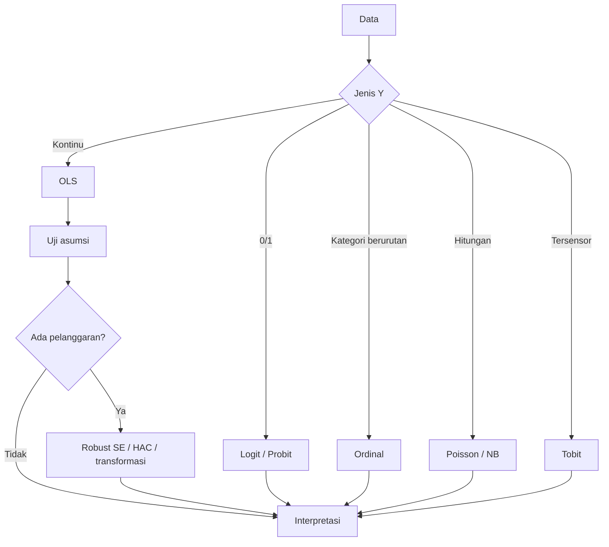

# Panduan Fasilitator: Workshop Ekonometrika dengan Google Colab

Panduan ini untuk pengajar atau presenter. Isinya jalur kegiatan sesuai
undangan 26 Oktober 2026, paket pendalaman dua hari, poin
mengajar per sesi, kesalahan umum peserta, dan rencana cadangan kalau ada
kendala teknis.

## Kegiatan sesuai undangan: satu hari untuk peserta pemula

Surat menetapkan Senin, 26 Oktober 2026, pukul 08.30 WIB sampai selesai,
di Ruang Gedung Hexagonal Lantai 2 Universitas Jambi, dengan tema
Ekonometrika berbasis AI dan Coding. Surat tidak menetapkan jadwal dua
hari, rincian latar belakang peserta, atau jam penutupan. Jadwal berikut
adalah usulan mengajar sampai sekitar pukul 15.00, untuk disesuaikan dengan
alokasi panitia.

| Perkiraan waktu | Materi | Cara mengajar |
|---|---|---|
| 08.30-09.15 | Panduan pemula dan Sesi 0 | Kenalkan sel, variabel, kolom, dan error; bantu menjalankan sel alamat data. |
| 09.15-10.15 | Sesi 1 | Jalankan OLS, baca satu koefisien, ubah satu nilai prediksi. |
| 10.15-10.30 | Istirahat | |
| 10.30-11.15 | Contoh inti Sesi 2 | Bandingkan garis lurus dan kuadratik, lalu jelaskan elastisitas log-log. |
| 11.15-12.00 | Contoh inti Sesi 3 | Basis dummy, VIF, Breusch-Pagan, dan HC3. |
| 12.00-13.00 | Istirahat | |
| 13.00-13.40 | Praktik AI | Pakai panduan/02_panduan_ai.md: jelaskan kode, periksa output, pahami satu error. |
| 13.40-14.40 | Praktik Lab 1 | Peserta mengubah contoh untuk kasus padi dan menjelaskan hasil. |
| 14.40-15.00 | Pembahasan | Koreksi interpretasi satuan, p-value, dan klaim sebab akibat. |

Target minimum: peserta dapat membaca CSV, menjalankan OLS, membaca
koefisien/p-value, membuat prediksi, dan memeriksa bantuan AI menggunakan
output aktual. Sesi 4-6 dan Lab 2-6 tetap dibagikan sebagai pendalaman.
Jika alokasi acara lebih singkat, utamakan persiapan, OLS, interpretasi,
dan satu latihan AI; beri waktu peserta menjalankan setiap langkah.

Mulai dengan `panduan/01_panduan_pemula.md`. Jelaskan setiap perintah baru saat
muncul. Peserta tidak diminta menulis fungsi, perulangan, optimisasi
likelihood, atau perkalian matriks. Perhitungan teknis Tobit tersedia
terbuka di `alat_bantu/metode_lanjutan.py` dan ikut paket ZIP.

## Gambaran umum

- **Hari 1 (dosen/pengajar):** mengenal Python untuk ekonometrika,
  menyiapkan bahan ajar, dan menuntaskan alur analisis dari regresi sampai
  model lanjutan.
- **Hari 2 (mahasiswa):** praktik terbimbing dengan latihan mandiri di
  setiap topik, ditutup proyek mini.
- **Alat:** Google Colab. Tidak perlu instalasi apa pun di laptop peserta.
- **Data:** notebook membaca CSV langsung dari GitHub melalui `URL_DATA`.
  Gunakan koneksi internet. Salinan lokal: 44 CSV aktif di `data/`, sedangkan
  15 CSV tambahan berada di `data/cadangan/`. Lab 6 memakai data Indonesia
  (IHSG, kurs, makro, panel ASEAN) dari salinan GitHub tersebut.
  [Peta pemakaian data](../panduan/08_peta_pemakaian_data.md) menunjukkan nama CSV per sesi.

## Benang merah mengajar

Materi ini satu cerita: Sesi 1 memasang model linear dan menunjukkan
kegagalannya, Sesi 2 memilih bentuk yang tepat, Sesi 3 menguji asumsi,
Sesi 4 mengganti jenis variabel Y, Sesi 5 menambah waktu, dan Sesi 6
menutup dengan panel serta GARCH. Hari 2 mengulang alur yang sama
sebagai latihan, lalu menutup dengan data Indonesia asli.

Dua kebiasaan yang menjaga alur tetap terasa di kelas:

1. Buka setiap sesi dengan membaca blok "Posisi dalam alur workshop" di
   notebook, satu menit saja.
2. Tutup setiap sesi dengan bagian "Selanjutnya" supaya peserta tahu
   kaitannya dengan pertemuan berikutnya. Bagikan `panduan/03_glosarium.md` sebagai
   rujukan istilah.

Satu kebiasaan lagi yang membuat kelas dua arah: setiap sesi punya 2
sampai 3 checkpoint "Coba sendiri" (total 21 tersebar dari Sesi 0 sampai
Lab 6). Hentikan demo saat checkpoint muncul, beri peserta 5 menit untuk
mencoba, baru buka jawabannya bersama-sama. Semua jawaban sudah dihitung
dan diverifikasi, jadi Anda bisa langsung mengoreksi.

## Checklist sebelum hari-H

1. Uji buka setiap notebook di Colab sekali, jalankan dari atas ke bawah.
2. Periksa koneksi internet dan tautan CSV. Salinan offline opsional ada di
   [paket/data_tutorial.zip](../paket/data_tutorial.zip); jika mengajar offline,
   pengajar menyiapkan kernel beserta pustaka dan mengganti `URL_DATA` menjadi alamat folder `data/` lokal.
3. Sesi 6 memakai paket `linearmodels` dan `arch` yang tidak tersedia di
   Colab secara bawaan. Sel `%pip install` sudah disiapkan di notebook,
   tapi butuh internet. Kalau ruangan tanpa internet, minta peserta
   menjalankan instalasi di awal saat masih ada koneksi.
4. Cetak atau siapkan `pengajar/kunci_jawaban/catatan_latihan.md` (Hari 1) dan folder `pengajar/kunci_jawaban/`
   (Hari 2) untuk Anda sendiri.
5. Siapkan akun Google peserta dan gladi bersih Colab menggunakan notebook
   serta ZIP terbaru. Siapkan salinan lokal jika koneksi bermasalah.

## Paket pendalaman Hari 1 (dosen): sekitar 8 jam 15 menit materi

| Waktu | Sesi | Notebook | Fokus |
|---|---|---|---|
| 08.30-09.00 | Pembukaan + setup | `00_persiapan_colab.py` | Colab, data, padanan EViews |
| 09.00-10.15 | Regresi dasar | `01_regresi_dasar.py` | OLS, uji t/F, R kuadrat, prediksi |
| 10.15-10.30 | Istirahat | | |
| 10.30-11.45 | Bentuk fungsional | `02_bentuk_fungsional.py` | log-log, reciprocal, polinomial |
| 11.45-13.00 | Istirahat | | |
| 13.00-14.30 | Dummy + asumsi klasik | `03_dummy_asumsi_klasik.py` | VIF, BP/White, JB, DW |
| 14.30-14.45 | Istirahat | | |
| 14.45-16.00 | Model kategorikal | `04_model_kategorikal.py` | logit, ordinal, tobit, poisson |
| 16.00-17.15 | Deret waktu | `05_deret_waktu_kointegrasi.py` | ADF, ARIMA, kointegrasi, ECM |
| 17.15-18.30 | Panel + GARCH | `06_panel_garch.py` | CEM/FEM/REM, GARCH |

Kalau waktu mepet, prioritas: sesi 1, 2, 3, lalu 4. Sesi 5 dan 6 bisa
diberikan sebagai bacaan mandiri dengan kunci yang sudah tersedia.

## Paket pendalaman Hari 2 (mahasiswa): sekitar 8 jam 45 menit materi

| Waktu | Lab | Fokus |
|---|---|---|
| 08.30-09.15 | `00_persiapan_colab.py` | Colab, data, regresi pertama |
| 09.15-10.45 | `01_regresi_dasar.py` | regresi dan interpretasi |
| 10.45-11.00 | Istirahat | |
| 11.00-12.30 | `02_bentuk_fungsional.py` | memilih bentuk model |
| 12.30-13.30 | Istirahat | |
| 13.30-15.00 | `03_dummy_asumsi_klasik.py` | dummy dan diagnostik |
| 15.00-16.15 | `04_model_kategorikal.py` | logit, ordinal, poisson |
| 16.15-17.15 | `05_deret_waktu_panel.py` | ADF, ARIMA, panel |
| 17.15-18.15 | `06_data_indonesia.py` | data asli: GARCH IHSG, panel ASEAN, makro Indonesia |
| 18.15-18.30 | `07_proyek_mini.md` | penjelasan tugas akhir |

Kalau waktu mepet, Lab 6 bisa dijadikan pekerjaan rumah. Datanya sudah
tersedia lokal dan kuncinya lengkap, jadi mahasiswa bisa mengerjakan
mandiri.

## Poin mengajar per sesi

Model utama memakai scikit-learn secara konsisten. Tunjukkan X dan y, buat model,
jalankan fit, baca coef_ serta intercept_, lalu predict. Nama `uji_...` menandai
pelengkap inferensi; jelaskan ketika peserta membutuhkan p-value atau diagnostik.
Untuk klasifikasi, bedakan predict (kelas) dan predict_proba (peluang).
Rinciannya ada di [panduan pemodelan](../panduan/06_pola_pemodelan.md).

### Sesi 1, regresi dasar
- Mulai dari scatter plot. Tanya peserta: "hubungannya garis lurus atau
  melengkung?" Pertanyaan ini yang menentukan bentuk model di sesi 2.
- Tunjukkan arti koefisien dengan angka konkret, bukan rumus.
- Tekankan `ceteris paribus`: koefisien adalah hubungan, bukan sebab
  akibat, kecuali desain penelitiannya mendukung.

### Sesi 2, bentuk fungsional
- Aturan praktis: log untuk persentase, reciprocal untuk titik jenuh,
  polinomial untuk pola naik-turun.
- Demo `regresi_polinom.csv` di sesi 1 sengaja gagal dengan model linear.
  Buka kembali di sesi ini sebagai pay-off: model kuadratik memperbaiki
  R kuadrat dari 0,007 ke 0,999.

### Sesi 3, dummy dan asumsi
- Dummy selalu punya kategori basis. Minta peserta menyebut basisnya
  sebelum menafsirkan.
- Urutan diagnostik: multikolinearitas, heteroskedastisitas, normalitas,
  autokorelasi.
- Pesan kunci: robust SE mengubah standard error, bukan koefisien.

### Sesi 4, model kategorikal
- Data kursus untuk logit (`logit-probit-1` sampai `-3`) terpisah
  sempurna. Ini dijelaskan di notebook sebagai pelajaran. Jangan panik
  kalau peserta bertanya kenapa koefisiennya ekstrem.
- Dataset Spector dipakai sebagai contoh bersih. Bisa dibandingkan dengan
  hasil di buku teks.

### Sesi 5, deret waktu
- Urutan tidak boleh dilompati: stasioner dulu, baru kointegrasi, baru
  ECM. Kasus IHSG-emas di kunci menunjukkan kenapa.
- ADF pada kurs adalah contoh patahan struktural.

### Sesi 6, panel dan GARCH
- Hausman klasik memakai estimasi FE dan RE dengan kovarians unadjusted,
  bukan selisih kovarians clustered. Pada data GDP, p sekitar 0,8648.
  Laporkan angka terbaru, asumsi, dan keterbatasan uji.
- GARCH pada data simulasi murni ARCH (beta = 0). Bandingkan dengan
  simulasi GARCH asli di notebook supaya peserta melihat persistensi.

### Lab 6, data Indonesia asli
- Ini penutup yang kuat: data asli dari World Bank, Yahoo Finance, ECB,
  OECD, dan kompilasi BPS, bukan simulasi.
- GARCH IHSG memberi hasil seperti di buku teks: beta 0,82 dan
  persistensi 0,95. Kontras dengan data simulasi (beta 0) yang sudah
  dibahas di Sesi 6.
- Panel ASEAN memakai uji Chow dan Hausman dengan data nyata; hasilnya
  memilih Fixed Effect dan koefisien FDI signifikan.
- Regresi inflasi dan pengangguran Indonesia menunjukkan tanda positif.
  Jangan buru-buru bilang "salah teori"; bahas konteks krisis 2005, 2008,
  dan 2020.
- Bagian krisis 1997-1998 memakai inflasi bulanan sejak 1968 dan kurs
  tahunan sejak 1967. Puncak inflasi 58 persen dan rupiah yang melemah
  244 persen pada 1998 adalah patahan struktural yang asli.
- Latihan GARCH jangka panjang memakai IHSG sejak 1990. Periode 1990-1999
  menyentuh IGARCH (alpha + beta = 1), temuan bagus untuk diskusi rezim
  krisis.
- Latihan cross-section memakai 34 provinsi 2021 (kemiskinan, IPM, PDRB).
  Cocok untuk mengulang materi bentuk fungsional dan heteroskedastisitas
  dengan data asli.
- Tunjukkan `panduan/04_referensi.md` dan script `unduh_data_indonesia.py` supaya
  mahasiswa bisa memperbarui atau mengambil data sendiri untuk proyek.

## Kendala yang sering muncul

| Kendala | Solusi cepat |
|---|---|
| Pembacaan CSV gagal | Periksa koneksi internet, URL_DATA, dan ejaan nama CSV; ulangi sel terkait |
| `ModuleNotFoundError: linearmodels` | Jalankan sel `%pip install linearmodels arch -q`, tunggu selesai, lanjutkan |
| Angka beda dengan kunci | Cek versi paket; jalankan `pip show statsmodels arch linearmodels` |
| Warning "Perfect Separation" | Bukan error; itu bahan diskusi di sesi 4 |
| Warning "non-invertible starting MA" | Periksa konvergensi estimasi akhir, parameter, dan diagnostik residual |
| Colab terputus | Jalankan ulang dari sel pertama; simpan salinan notebook ke Drive |

## Bahan latihan tambahan

Sebanyak 15 CSV di [data/cadangan/](../data/cadangan/README.md) belum dipakai
oleh 23 notebook saat ini. Pengajar dapat memilihnya untuk latihan tambahan;
peserta cukup memakai data pada [peta pemakaian data](../panduan/08_peta_pemakaian_data.md).
Beberapa pilihan tambahan:

| File data | Kasus | Latihan yang disarankan |
|---|---|---|
| `uts_5.csv` | kriminalitas vs pengangguran, pendidikan, kepadatan | regresi berganda dan interpretasi |
| `data_regresi_uts.csv` | 100 observasi dengan kolom tren dan error | latihan uji spesifikasi model |
| `latihan_normalitas_2.csv` | hasil panen | uji normalitas residual |
| `logit_probit_3.csv` | adopsi mobile banking | ulangi pelajaran perfect separation |
| `tobit_data_2_jamkerja.csv` | jam kerja tersensor di nol | estimasi Tobit MLE |
| `tobit_data_3_asuransi.csv` | premi asuransi tersensor di nol | estimasi Tobit MLE |
| `poisson_data_3_cacat.csv` | cacat produksi per batch | Poisson dan cek overdispersi |
| `ekspor_kurs.csv` | ekspor dan nilai tukar | ADF, kointegrasi, lalu ECM |
| `ritel_iklan.csv` | penjualan ritel dan iklan digital | regresi tren atau ARIMA |
| `panel_kesehatan.csv` | tekanan darah pasien | panel CEM, FEM, REM |
| `panel_pendidikan.csv` | nilai ujian siswa | panel CEM, FEM, REM |
| `kredit_default.csv` | 1.000 nasabah kartu kredit (data asli UCI, bukan Indonesia) | logit dengan data asli tanpa perfect separation |

## Penilaian dan tindak lanjut

- Hari 1: tidak ada penilaian formal. Fokus pada kelancaran demo dan tanya
  jawab.
- Hari 2: nilai latihan dari jawaban yang peserta tulis di notebook,
  ditambah proyek mini dengan rubrik di `07_proyek_mini.md`.
- Tindak lanjut: cocokkan dengan RPS 16 pertemuan. Sesi 1-7 di RPS bisa
  memakai notebook 00-03, sesi 9-11 memakai notebook 04, sesi 12-15
  memakai notebook 05-06.

## Penutup pilihan: dashboard ekonomi Indonesia (60 menit)

Gunakan [notebook dashboard](../materi/04_dashboard_indonesia/01_dashboard_ekonomi.ipynb).
Seluruh aplikasi dibuat dan dijalankan dari notebook. Data yang dipakai hanya
`provinsi_2021.csv`, dibaca langsung dari GitHub dengan koneksi internet.
Peserta menjalankan seluruh langkah dari notebook.

| Waktu | Kegiatan |
|---|---|
| 10 menit | Membaca definisi IPM, pengangguran, dan kemiskinan serta menyiapkan data. |
| 15 menit | Menambahkan judul, filter provinsi, ringkasan, dan grafik. |
| 15 menit | Membaca kode regresi, evaluasi data uji, dan slider skenario. |
| 10 menit | Menjalankan server serta membuka pratinjau dari sel notebook. |
| 10 menit | Presentasi singkat: pola data, perubahan prediksi, dan satu keterbatasan. |

Tunjukkan bahwa ringkasan menggunakan rata-rata antarprovinsi tanpa bobot penduduk,
serta bahwa data berasal dari 2021. Jumlah provinsi kecil dan R² data uji dapat rendah
atau negatif. Tujuan sesi adalah menyajikan analisis yang dapat dicoba serta dijelaskan;
simulasi tidak menunjukkan dampak sebab akibat.

Jika waktu terbatas, pengajar dapat menyiapkan aplikasi dengan menjalankan notebook
terlebih dahulu. Peserta mulai dari menggunakan filter, kemudian menyunting judul atau
satu pilihan grafik. Setelah selesai, hentikan proses melalui sel terakhir.

## Peta alur analisis

